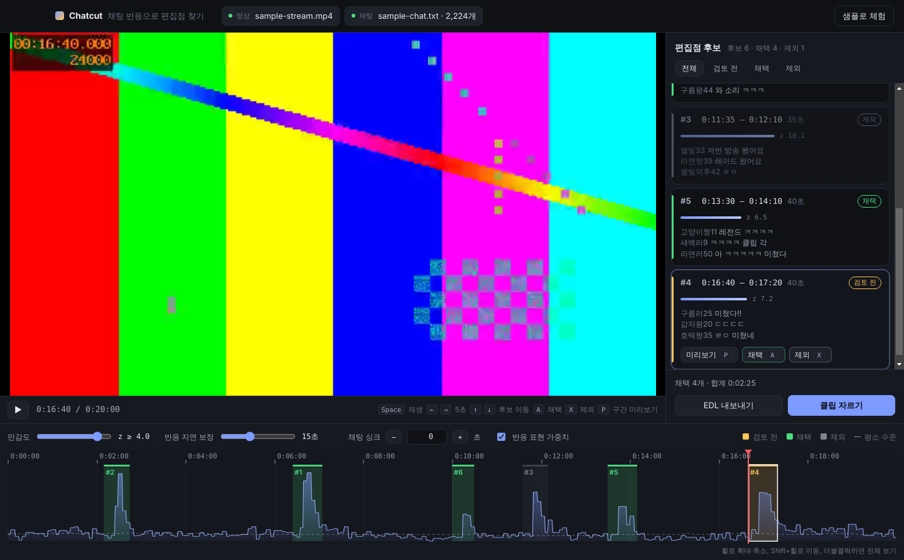

# Chatcut

게임 방송의 채팅 반응이 몰린 구간을 찾아 **편집점 후보**로 표시하는 데스크톱 앱입니다.
Electron과 TypeScript로 만들었습니다.

후보는 Chatcut이 찾아 주고, 쓸지 말지는 편집자가 정합니다. 채택한 구간은 EDL로 내보내 Premiere Pro나 DaVinci Resolve에서 바로 이어 편집하거나, 원본에서 클립 파일로 잘라낼 수 있습니다.



## 왜 만들었나

게임 스트리머는 방송이 길고 편집자를 자주 구합니다. 편집자가 가장 오래 붙잡는 일은 몇 시간짜리 원본을 처음부터 돌려 보며 쓸 장면을 찾는 일입니다.

시청자는 재밌는 장면에서 가장 먼저, 가장 크게 반응합니다. 그래서 채팅 반응이 몰린 구간을 원본 위에 표시하고, 편집자가 그 구간만 확인할 수 있게 하면 찾는 시간을 크게 줄일 수 있다고 봤습니다.

## 쓰는 흐름

1. 원본 영상과 채팅 로그를 끌어다 놓습니다. 영상이 없어도 그래프와 후보 목록은 볼 수 있습니다.
2. 반응 그래프와 후보 구간이 타임라인에 그려지고, 오른쪽에 점수 순으로 후보가 나열됩니다. 후보마다 그 순간의 대표 채팅이 함께 보입니다.
3. `↑` `↓`로 후보를 넘기며 확인하고 `A`(채택) 또는 `X`(제외)를 누릅니다. `P`를 누르면 그 구간만 재생하고 멈춥니다.
4. 채택한 구간을 **EDL로 내보내거나** **클립으로 자릅니다**.

| 키 | 동작 |
| --- | --- |
| `Space` | 재생 / 일시정지 |
| `←` `→` | 5초 이동 (`Shift`와 함께 누르면 1초) |
| `↑` `↓` 또는 `K` `J` | 이전 / 다음 후보 |
| `A` / `X` / `U` | 채택 / 제외 / 검토 전으로 되돌리기 |
| `P` | 선택한 구간만 미리보기 |
| 타임라인 휠 | 커서 기준 확대와 축소 (`Shift`+휠은 좌우 이동, 더블클릭은 전체 보기) |

## 실행

```bash
git clone https://github.com/JJonyeok2/Chat_cut.git && cd Chat_cut
npm install          # Electron, ffmpeg, ffprobe 바이너리까지 함께 설치됩니다
npm run sample       # 20분짜리 체험용 영상과 채팅 로그 생성 (sample/)
npm start            # 빌드 후 앱 실행 → "샘플로 체험" 버튼
npm test             # 분석 로직과 채팅 파서 테스트
```

macOS에서는 `run.command`를 더블클릭해도 설치, 샘플 생성, 실행이 한 번에 진행됩니다.

샘플에는 실제 편집점 6개(낙사, 클러치, 깜짝 놀람, 후원 리액션, 역전승, 작은 실수)와 함께, **채팅은 많지만 편집점은 아닌 구간**(레이드 입장 인사 러시)을 일부러 넣었습니다. 정답은 `sample/events.json`에 있습니다.

## 설계하면서 내린 판단

**"많다"의 기준을 고정하지 않았습니다.**
채팅량은 방송마다, 같은 방송 안에서도 시간대마다 다릅니다. 시청자가 늘어난 후반부는 평소 채팅도 많습니다. 그래서 전체 평균 대신 주변 10분의 **이동 중앙값**을 "평소"로 두고, 그보다 얼마나 튀었는지(robust z-score)로 판단합니다. 평균과 표준편차는 큰 폭발 한 번에 끌려가므로 중앙값과 MAD(중앙 절대 편차)를 썼습니다.

**채팅은 장면보다 늦게 반응합니다.**
시청자가 장면을 보고, 웃고, 타이핑하는 데 몇 초가 걸립니다. 반응이 시작된 시점을 그대로 자르면 정작 장면의 앞부분이 잘립니다. 그래서 후보 시작을 기본 15초 앞으로 당기고, 이 값(반응 지연 보정)을 편집자가 조절할 수 있게 했습니다.

**반응의 양뿐 아니라 종류를 봅니다.**
레이드가 들어오면 "ㅎㅇ"가 쏟아지지만 편집점은 아닙니다. `ㅋㅋ`, `ㄷㄷ`, `미쳤다`, `클립` 같은 반응 표현에 가중치를 주면, 샘플에서 놓쳤던 "깜짝 놀람" 장면이 후보에 들어오고 입장 인사 구간은 순위가 내려갑니다. 그래도 완벽히 걸러지지는 않습니다. 그래서 최종 판단을 편집자에게 남기는 구조로 만들었습니다.

**민감도를 바꿔도 편집자의 판단은 남습니다.**
민감도나 싱크를 바꾸면 후보 구간이 전부 다시 계산됩니다. 이때 이미 채택하거나 제외한 판단이 사라지면 편집자는 같은 일을 두 번 해야 합니다. 새 구간이 가장 많이 겹치는 기존 구간의 판단을 이어받도록 했습니다 (`carryDecisions`).

**결과물은 편집자가 이어서 작업할 수 있는 형태로 냅니다.**
EDL(CMX3600)은 Premiere Pro와 DaVinci Resolve가 모두 읽는 형식이라, 채택한 구간이 편집 프로그램 타임라인에 바로 놓입니다. 클립 자르기는 재인코딩 없이 스트림 복사(`-c copy`)를 써서 몇 시간짜리 원본도 몇 초 만에 끝납니다. 대신 키프레임 단위로 잘려 앞쪽이 1~2초 더 붙을 수 있는데, 편집자가 다시 다듬을 소스라 속도를 택했습니다.

**긴 방송도 버티게 했습니다.**
텍스트 로그는 한 줄씩 스트리밍으로 읽고, 메시지 전체를 메모리에 들고 있지 않습니다. 1초 단위 카운트와 구간별 대표 메시지 몇 개만 남깁니다. 6시간 방송, 채팅 약 36만 줄(18MB)로 측정했을 때 파싱 0.5초, 분석 0.07초, 힙 약 34MB였습니다. 타임라인은 픽셀마다 최댓값만 그려서 확대 수준과 관계없이 그리는 양이 화면 폭에 비례합니다.

## 구조

```
src/
├── main/                 Electron main 프로세스
│   ├── main.ts           창, 파일 대화상자, IPC
│   ├── preload.ts        renderer에 노출하는 API (contextIsolation, sandbox)
│   ├── chatParser.ts     채팅 로그 스트리밍 파서
│   └── media.ts          ffprobe 영상 정보, ffmpeg 클립 자르기 (중단 가능)
├── shared/               main과 renderer가 함께 쓰는 순수 로직
│   ├── analysis.ts       급증 탐지, 구간 병합, 판단 승계, 타임코드, EDL
│   └── types.ts
└── renderer/             화면
    ├── store.ts          reducer 기반 상태 관리 (파생 상태는 reducer 안에서만 계산)
    ├── timeline.ts       canvas 타임라인 (확대, 이동, 스크럽)
    └── app.ts            화면 연결, 단축키, 내보내기
```

## 지원하는 채팅 로그 형식

| 형식 | 예시 |
| --- | --- |
| 텍스트 | `[0:12:34] 닉네임: 메시지`, `[2026-10-20 21:03:11] 닉네임: 메시지`, `12:34 닉네임: 메시지` |
| JSON 배열 | `[{ "time": 754, "user": "닉네임", "message": "ㅋㅋㅋ" }]` (time은 초 또는 `"0:12:34"`) |
| TwitchDownloader JSON | `{ "comments": [{ "content_offset_seconds": 754, "commenter": {...}, "message": { "body": "..." } }] }` |
| NDJSON | 한 줄에 위 JSON 객체 하나 |

시각(시:분:초) 기준 로그는 첫 메시지를 0초로 맞추고 자정을 넘기는 방송도 이어 붙입니다. 영상이 방송 도중부터 녹화됐다면 **채팅 싱크** 값으로 맞춥니다 (영상 시각 = 채팅 시각 − 싱크 값).

## 한계와 다음 단계

- 채팅만 신호로 씁니다. 다음 단계로 **오디오 음량 급증**(스트리머의 비명, 웃음)과 결합하면 채팅이 적은 소규모 방송에서도 후보를 잡을 수 있습니다.
- 가중치 단어 목록은 직접 정했습니다. 편집자가 채택하고 제외한 기록이 쌓이면, 어떤 반응이 실제 편집점으로 이어지는지 그 데이터로 가중치를 조정할 수 있습니다.
- 치지직이나 유튜브 라이브의 채팅을 앱 안에서 바로 수집하는 기능은 아직 없습니다.

## 만든 사람

전종혁 ([JJonyeok2](https://github.com/JJonyeok2))
